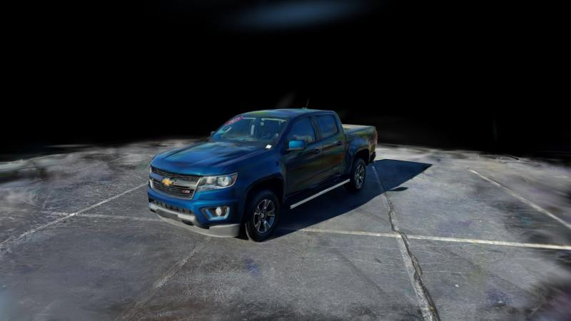
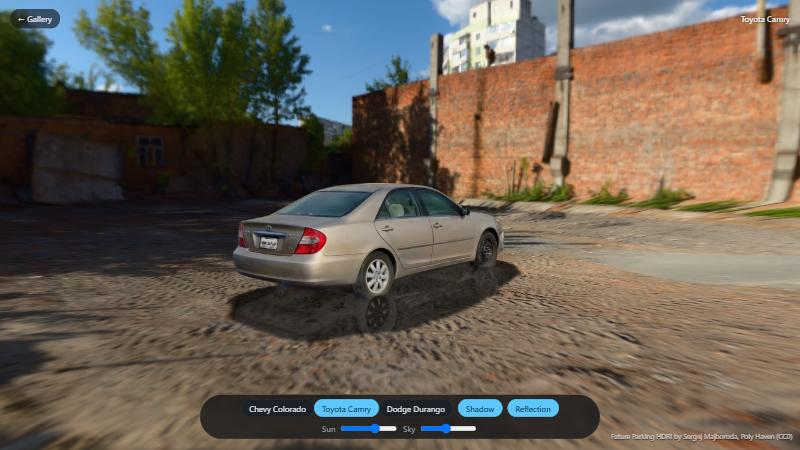

# Beta Splatting Showcase

A zero-build web gallery for **beta splatting** / Gaussian splatting captures. Open a scene and get a
real-time 3D viewer with a cinematic camera tour, an orbit lock that keeps the camera inside the captured
area, and one-click video recording.

**[▶ Live demo](https://neelgajera.github.io/beta-splatting-showcase/)**

[](https://neelgajera.github.io/beta-splatting-showcase/viewer.html?scene=chevy)

*Chevy Colorado, reconstructed from a 70-second phone walk-around with
[video-to-splat](https://github.com/neelgajera/video-to-splat). The licence plate was replaced in 3D before
training, and the 261k-primitive model (31 MB) streams from
[Hugging Face](https://huggingface.co/neelgajera09/beta-splatting-showcase-models).*

## Studio: the cars in a photo studio or a real environment

**[▶ Open the Studio](https://neelgajera.github.io/beta-splatting-showcase/studio.html)**



[`studio.html`](studio.html) places the reconstructed cars in a studio or an outdoor scene with
[PlayCanvas](https://playcanvas.com) 2.22. Three environments are switchable in the toolbar
([`studio.json`](studio.json)):

- **Studio / Dark studio**: a seamless *cyclorama*, a floor curving up into the wall, built as real geometry
  (a revolved profile in [`js/studio.js`](js/studio.js)), like a car-photography studio. A studio HDRI
  (Poly Haven *Studio Small 09*) provides image-based lighting only and isn't shown. A high key light gives a
  short, soft contact shadow.
- **Car park**: an outdoor HDRI (Poly Haven *Future Parking*) projected onto a sky *dome*, so the car stands on
  the environment's own ground, with a low sun.

Projecting indoor HDRIs onto the dome was tried and dropped: a room's walls are at varying distances, so they
warp around the car. The cyclorama avoids that.
- **Solid shadows and reflections from a proxy mesh.** Splats cast shadows through an alpha-clipped pass, so
  thin or semi-transparent regions let light through, and sparse areas leave gaps in reflections.
  [`tools/splat_to_mesh.py`](tools/splat_to_mesh.py) renders colour and depth of each car from its 180 capture
  views plus 48 views from above, back-projects the opaque pixels to oriented points, and reconstructs a closed
  surface with screened Poisson (~40k triangles, ~700 KB). The studio draws this mesh twice: invisibly into the
  shadow map (depth only, no colour), and vertex-coloured on a layer only the reflection camera renders. The
  splats themselves are untouched on screen.
- **Light**: a directional key light per environment (elevation, intensity and shadow strength in
  `studio.json`) whose shadow lands on a shadow catcher. Drag the *Light* slider to move it around the car.
- **Reflections**: a blurred planar reflection under the car. The PlayCanvas script was modified
  ([`js/vendor/blurred-planar-reflection.mjs`](js/vendor/blurred-planar-reflection.mjs)) to render transparently
  (so the reflection fades into the real ground instead of an opaque floor colour) and to accept extra layers
  for the proxy mesh.
- **Tone mapping**: the splat colours come from phone photos that are already tone-mapped, so the studio uses
  exposure 1 with the Khronos PBR Neutral tone mapper (identity up to ~0.8). The cars keep their captured
  colours while the HDRI's highlights are still compressed. ACES had darkened and desaturated them, a
  double tone map. The *Brightness* slider changes only the backdrop or sky, never the car.
- **Real scale**: each car is scaled to its real length (Colorado 5.40 m, Camry 4.81 m, Durango 5.11 m). The
  heights that result, 1.4–1.7 m, match the real cars, which is a good check on the reconstructions.

PlayCanvas renders standard 3DGS, so [`tools/beta_to_3dgs.py`](tools/beta_to_3dgs.py) converts each
Beta-splatting model (cut out of its scene with [splat-segment](https://github.com/neelgajera/splat-segment)):

- **Kernel**: Beta splatting rasterizes a 2D kernel (1 − r²)^b over each primitive's projected footprint. It
  becomes a Gaussian with the same total opacity over that footprint, σ = s / √(2b + 2). (Matching variance
  instead gives ~18% narrower splats, which made thin regions see-through.)
- **View-dependent colour**: Beta splatting's spherical-beta lobes are sampled over 256 view directions per
  primitive and least-squares fitted with degree-3 spherical harmonics (RMS fit error 0.09–0.11 on 0–1
  colour; sharp highlights are softened).
- **Frame**: rotated so the cameras' up vector is +Y, with the ground (1st height percentile) at y = 0 and the
  car centred. Primitives below the ground are dropped, and so are flat, horizontal splats just above it:
  leftover asphalt and contact shadow from the original scene, which show as dark smears on a plain studio
  floor (140–190 per car). The SH are fitted in the new frame.

## Features

- **Gallery** generated from `scenes.json`: thumbnails, splat counts and file sizes.
- **Beta splatting renderer**: a modified [GaussianSplats3D](https://github.com/mkkellogg/GaussianSplats3D)
  that reads the `beta` and `sb_params_*` fields written by
  [Deformable Beta Splatting](https://github.com/RongLiu-Leo/beta-splatting).
- **Cinematic tour**: a smooth closed loop through the real capture cameras, always aimed at the subject.
  It plays automatically and stops when you drag.
- **Orbit lock**: zoom and tilt limits taken from the capture, so viewers can't fly into unreconstructed areas.
- **Record**: saves exactly one loop of the tour as a `.webm` video with the UI hidden.
- **Progressive loading**: first splats appear in about 0.4 s, whatever the model size.
- **Static**: plain HTML and ES modules, `three` from a pinned CDN. It runs on GitHub Pages, Netlify or any file host.

## Quick start

```bash
node server.js            # http://localhost:8080
```

Node is used only for the dev server (no dependencies). Opening `index.html` straight from disk won't work,
because browsers block `fetch()` on `file://` URLs.

Keyboard in the viewer: **Space** tour · **F** fullscreen · **L** orbit lock · **R** camera ring.

## Add your own scene

1. **Put the model in `models/`.** It can be any beta-splatting PLY, or a standard 3DGS PLY with
   `f_dc_*`, `opacity`, `scale_*` and `rot_*` fields.
   Optionally shrink it by dropping almost-transparent splats:
   ```bash
   python tools/prune_ply.py big.ply models/my-car.ply --min-opacity 0.05
   ```
   If you have the training cameras, fix view-dependent color artifacts. These are splats whose
   spherical-beta lobes turn a wrong color from angles the capture never saw:
   ```bash
   python tools/fix_view_artifacts.py --ply models/my-car.ply --cameras cameras.json --config configs/my-car.json --out models/my-car.ply
   ```
   This needs the config from step 2, so run step 2 first and then come back.
2. **Generate the scene config** (up vector, orbit center, camera ring, tour path). Requires `numpy`.
   - If you have the training cameras (`cameras.json` from the training output):
     ```bash
     python tools/compute_scene_config.py --ply models/my-car.ply --cameras path/to/cameras.json --out configs/my-car.json
     ```
   - Without cameras, give an up axis, a start position and a look-at point (find them by orbiting in the viewer):
     ```bash
     python tools/compute_scene_config.py --ply models/my-car.ply --up 0,0,1 --start 0.9,3.3,0.3 --look 0,0,0 --out configs/my-car.json
     ```
3. **Add an entry to `scenes.json`:**
   ```json
   { "id": "my-car", "title": "My Car", "subtitle": "Outdoor capture",
     "model": "models/my-car.ply", "config": "configs/my-car.json", "thumbnail": "thumbs/my-car.jpg" }
   ```
4. **Make a thumbnail:** run `node server.js --save-thumbs` and open
   `http://localhost:8080/viewer.html?scene=my-car&thumb=1`. The page renders one frame and writes `thumbs/my-car.jpg`.

You can also open a model without editing `scenes.json`:
`viewer.html?model=models/my-car.ply&config=configs/my-car.json&title=My%20Car`.

## Hosting the models

`models/*.ply` is git-ignored by default, because splat files are large (35–80 MB each). Options:

- **Commit them.** GitHub allows files up to 100 MB, and GitHub Pages serves them as-is.
  Remove the `models/*.ply` line from `.gitignore`.
- **Hugging Face, an S3/R2 bucket or a CDN.** Upload the PLYs and set each scene's `"model"` in `scenes.json`
  to the full URL. The host must send CORS headers (Hugging Face does; for buckets, enable CORS).
  GitHub Release assets don't send CORS headers, so browsers can't load them directly.

Git LFS files are *not* served by GitHub Pages.

## Private scenes

Captures you can view but not publish go in `private/` (git-ignored), with their own manifest
`private/scenes.json` in the same format and paths like `private/models/x.ply`. The dev server appends those
scenes to the gallery, and `--save-thumbs` writes their thumbnails to `private/thumbs/`. A static host only
serves the public `scenes.json`, so private scenes never appear in the deployed gallery.

## Project layout

```
index.html, viewer.html   gallery and viewer pages
css/, js/                 styles and viewer logic
lib/                      modified GaussianSplats3D build with beta-splatting support (MIT)
scenes.json               gallery manifest
configs/                  per-scene camera/tour configs (+ training cameras where available)
models/                   PLY files (git-ignored)
private/                  captures that must not be published (git-ignored, dev server only)
thumbs/                   gallery thumbnails
tools/                    config generator, PLY pruning, beta → 3DGS PLY converter
bench/                    load-time benchmark used to compare viewers and models (dev only)
server.js                 zero-dependency dev server
```

## Credits and licenses

- Showcase code: MIT, see [LICENSE](LICENSE).
- [`lib/gaussian-splats-3d.module.js`](lib/) is a modified build of
  [GaussianSplats3D](https://github.com/mkkellogg/GaussianSplats3D) by Mark Kellogg (MIT,
  [license](lib/LICENSE-gaussian-splats-3d)), extended to render beta splatting kernels.
- [three.js](https://threejs.org) (MIT), loaded from jsDelivr.
- Beta splatting: *Deformable Beta Splatting*, Rong Liu et al.,
  [github.com/RongLiu-Leo/beta-splatting](https://github.com/RongLiu-Leo/beta-splatting).
- The camera ring / tour idea follows the torus-orbit setup used in 360° vehicle capture pipelines.

Models and captures are not covered by the MIT license. Only publish captures you have the rights to share.
